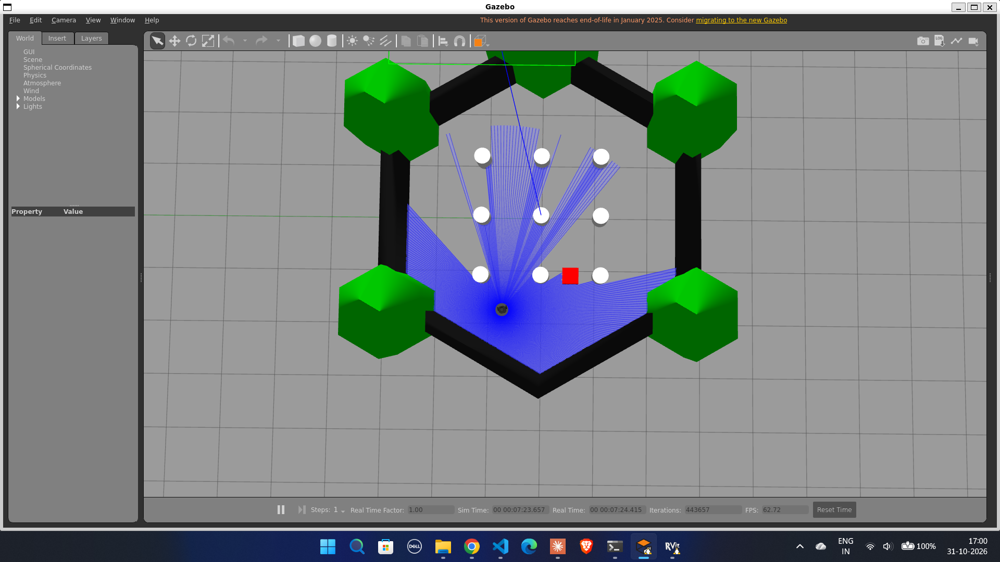
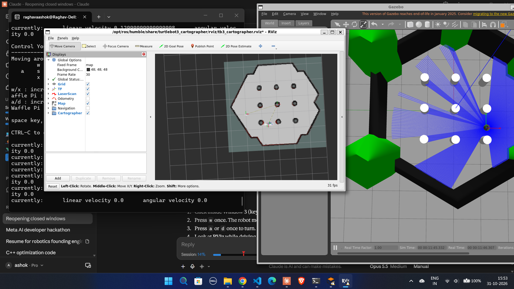
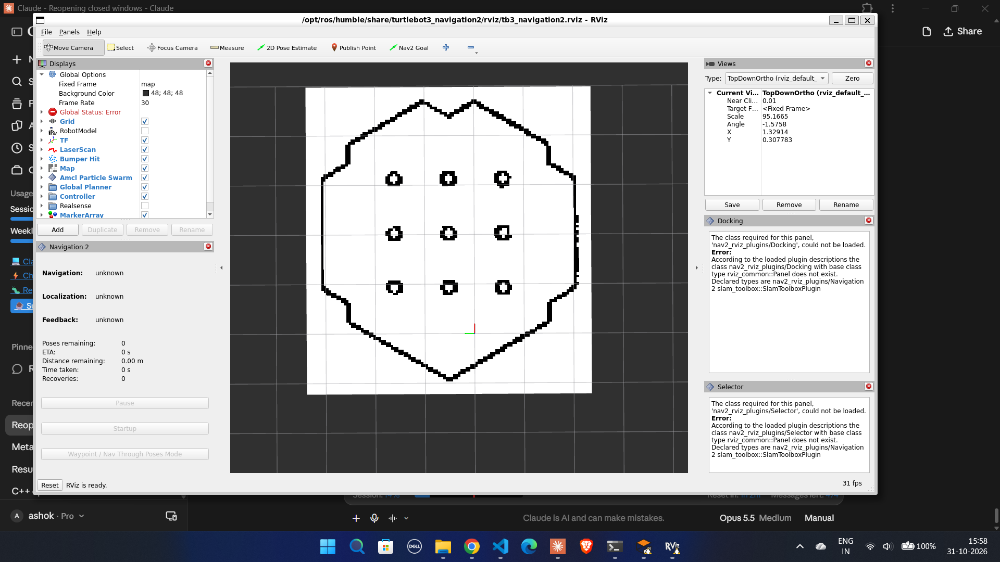
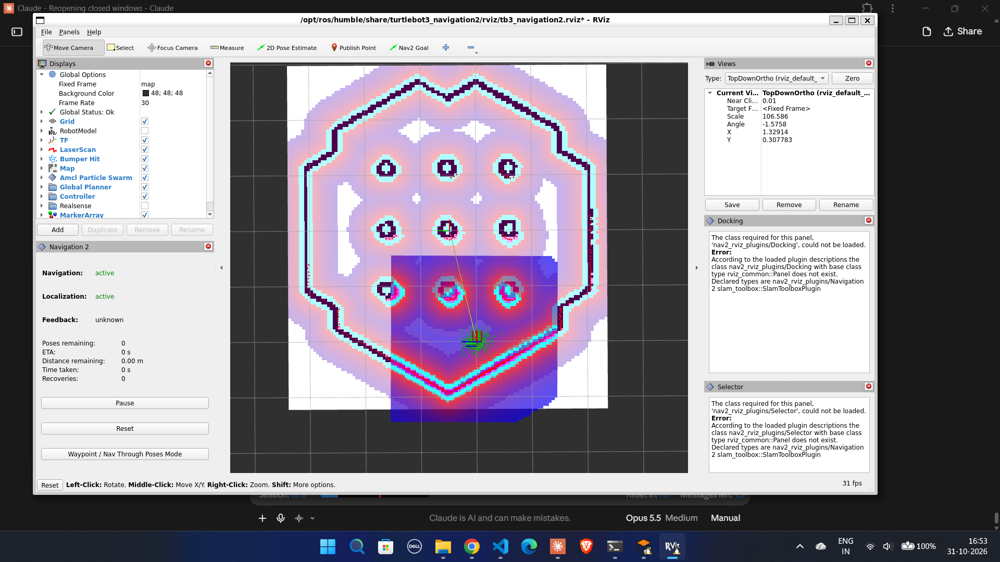
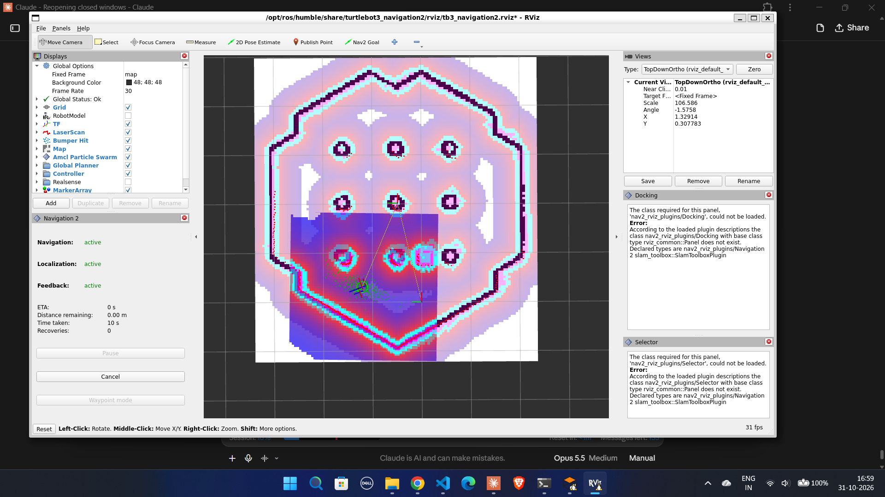
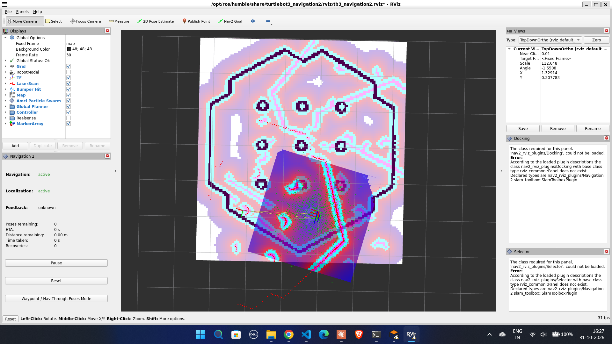
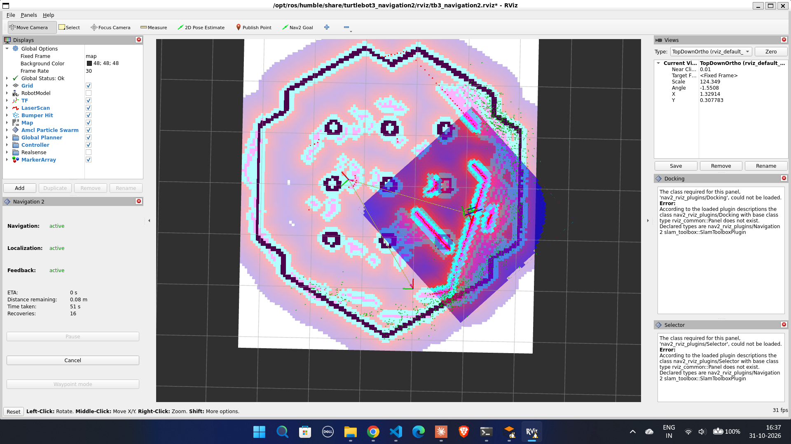

# TurtleBot3 Autonomous Navigation with ROS 2 Nav2 (Gazebo)

Take-home assignment for the **Robotics Software Intern** role at **Antropi Robotics**.

The goal: set up a TurtleBot3 in Gazebo, configure the ROS 2 Navigation2 (Nav2) stack, and show the robot driving to a goal by itself while avoiding obstacles.

**Demo video:** `<paste your video link here>`



---

## What I built

1. Set up ROS 2 Humble + Gazebo Classic on Windows 11 using WSL2.
2. Spawned TurtleBot3 Burger in the standard `turtlebot3_world` (a hexagon arena with 9 pillars).
3. Built my own map of the world with **Cartographer SLAM**, by driving the robot with the keyboard.
4. Loaded that map into **Nav2** and localized the robot with **AMCL**.
5. Sent goals in RViz. The robot planned a path around the pillars and drove there autonomously.
6. Added a **new box that is not in the map**. The robot detected it with its LiDAR and chose a different gap to reach the goal.

No custom navigation algorithm was written. I used the standard Nav2 stack and TurtleBot3 packages, as allowed in the assignment.

---

## My setup

| Item | Version / choice |
|---|---|
| Host OS | Windows 11 (Dell laptop) |
| Linux | Ubuntu 22.04 on **WSL2** (GUI through WSLg) |
| ROS 2 | **Humble** |
| Simulator | Gazebo Classic 11 |
| Robot | TurtleBot3 **Burger** (360° LiDAR) |
| World | `turtlebot3_world` |
| SLAM | Cartographer |
| Navigation | Nav2 (AMCL, global planner, controller, costmaps) |
| DDS | CycloneDDS (`rmw_cyclonedds_cpp`) |
| GPU | NVIDIA RTX 3050 6GB used for Gazebo/RViz rendering in WSL |

**Why this stack:** I was new to ROS, Gazebo and Nav2. Humble + Gazebo Classic has the most tutorials and answered questions online, so it was the safest path for a first project. Newer distros (Jazzy and later) use the new Gazebo, with different packages and steps.

---

## Repository structure

```
turtlebot3-nav2-gazebo/
├── README.md               ← this file
├── maps/
│   ├── map.pgm             ← my SLAM map (image)
│   └── map.yaml            ← map metadata (resolution 0.05 m, origin)
├── models/
│   └── box.sdf             ← small red box for the obstacle test
├── scripts/
│   ├── env_setup.sh        ← one-time ~/.bashrc setup
│   ├── 1_start_gazebo.sh   ← Gazebo world
│   ├── 2_start_slam.sh     ← Cartographer SLAM + RViz (mapping)
│   ├── 3_teleop.sh         ← keyboard driving (mapping)
│   ├── 4_save_map.sh       ← save the map into maps/
│   ├── 5_start_nav2.sh     ← Nav2 with the saved map
│   ├── 6_set_initial_pose.sh ← exact start pose for AMCL
│   └── 7_spawn_box.sh      ← add the obstacle box
└── media/                  ← screenshots
```

---

## Setup instructions

### 1. Install Ubuntu 22.04 on WSL2 (Windows only)

In PowerShell (Run as administrator):

```powershell
wsl --install -d Ubuntu-22.04
```

Restart if asked, then create a Linux username and password. Skip this step on native Ubuntu 22.04.

### 2. Update Ubuntu

```bash
cd ~
sudo apt update && sudo apt upgrade -y
```

### 3. Add the ROS 2 apt source

```bash
sudo apt install -y software-properties-common curl
sudo add-apt-repository universe -y
sudo curl -sSL https://raw.githubusercontent.com/ros/rosdistro/master/ros.key -o /usr/share/keyrings/ros-archive-keyring.gpg
echo "deb [arch=$(dpkg --print-architecture) signed-by=/usr/share/keyrings/ros-archive-keyring.gpg] http://packages.ros.org/ros2/ubuntu $(. /etc/os-release && echo $UBUNTU_CODENAME) main" | sudo tee /etc/apt/sources.list.d/ros2.list
sudo apt update
```

### 4. Install ROS 2 Humble

```bash
sudo apt install -y ros-humble-desktop
```

### 5. Install Gazebo, Nav2, Cartographer and TurtleBot3

```bash
sudo apt install -y \
  ros-humble-gazebo-ros-pkgs \
  ros-humble-navigation2 ros-humble-nav2-bringup \
  ros-humble-cartographer ros-humble-cartographer-ros \
  ros-humble-turtlebot3 ros-humble-turtlebot3-msgs \
  ros-humble-turtlebot3-simulations \
  ros-humble-rmw-cyclonedds-cpp
```

### 6. Clone this repo and set up the environment

```bash
cd ~
git clone https://github.com/Raghava2004-cpu/turtlebot3-nav2-gazebo.git
cd turtlebot3-nav2-gazebo
chmod +x scripts/*.sh
bash scripts/env_setup.sh
source ~/.bashrc
echo $TURTLEBOT3_MODEL     # should print: burger
```

`env_setup.sh` adds these lines to `~/.bashrc`:

```bash
source /opt/ros/humble/setup.bash
source /usr/share/gazebo/setup.sh
export TURTLEBOT3_MODEL=burger
export GAZEBO_MODEL_PATH=$GAZEBO_MODEL_PATH:/opt/ros/humble/share/turtlebot3_gazebo/models
export RMW_IMPLEMENTATION=rmw_cyclonedds_cpp
export MESA_D3D12_DEFAULT_ADAPTER_NAME=NVIDIA   # WSL2 + NVIDIA only
```

- **CycloneDDS:** with the default DDS on Humble, Nav2 is known to drop messages or hang. CycloneDDS is more stable.
- **NVIDIA line (WSL only):** see the GPU note in [Challenges](#challenges-i-faced-and-how-i-solved-them). Remove it if you have no NVIDIA GPU or Gazebo shows a black screen.

---

## How to run

Run every command from the repo folder. Use **one terminal per command**. Wait for each window to open before starting the next.

### Part A – Navigation demo (uses the map already in `maps/`)

| Terminal | Command | What it does |
|---|---|---|
| 1 | `./scripts/1_start_gazebo.sh` | Opens Gazebo with the robot and pillars |
| 2 | `./scripts/5_start_nav2.sh` | Starts Nav2 and opens RViz with my map |
| 3 | `./scripts/6_set_initial_pose.sh` | Tells AMCL the exact start pose |

Then in **RViz**:

1. Check the red laser dots sit on the black walls and pillars, and the green AMCL particles are in a tight group.
2. Click **Nav2 Goal**, click a free spot on the map, drag to set the final heading, release.
3. The robot plans a path and drives there by itself.

> `6_set_initial_pose.sh` is correct only right after a fresh start, before the robot moves. If the robot has already moved, use **2D Pose Estimate** in RViz instead.

### Part B – Obstacle test (new box not in the map)

1. Send the robot back near its start (bottom-middle of the arena).
2. Terminal 4: `./scripts/7_spawn_box.sh` → a red 0.3 m box appears in the gap between two bottom-row pillars.
3. In RViz, send a **Nav2 Goal** to the open space between the middle and top rows of pillars.
4. The box appears in the costmap. The planner avoids that gap and the robot goes through a different one.

To remove the box: right-click it in Gazebo → **Delete**.

### Part C – Rebuild the map yourself (optional)

| Terminal | Command |
|---|---|
| 1 | `./scripts/1_start_gazebo.sh` |
| 2 | `./scripts/2_start_slam.sh` |
| 3 | `./scripts/3_teleop.sh` |

Click in Terminal 3 and drive slowly (`w`/`x` speed, `a`/`d` turn, `s` stop) around every pillar until the RViz map is fully grey with clear black walls. Then, with SLAM still running:

```bash
./scripts/4_save_map.sh
```

This writes `maps/map.pgm` and `maps/map.yaml`. Close SLAM and teleop with `Ctrl+C`.

---

## How it works

```
 LiDAR + wheel odometry
          │
          ▼
 ┌──────────────────┐   mapping phase (once)
 │ Cartographer SLAM│ ──► maps/map.pgm + map.yaml
 └──────────────────┘
          │
          ▼   navigation phase
 ┌──────────────────┐
 │   Map Server     │  loads the saved map
 │   AMCL           │  finds the robot pose on the map (particle filter)
 │ Global Costmap   │  map + inflation (safety margin around obstacles)
 │ Global Planner   │  plans a path from robot to goal
 │ Local Costmap    │  live LiDAR obstacles around the robot
 │ Controller       │  follows the path, sends /cmd_vel to the wheels
 │ BT Navigator     │  runs the whole flow, triggers recoveries if stuck
 └──────────────────┘
```

- **SLAM (Cartographer):** builds the map while tracking the robot's position. I drove the robot manually for this.
- **AMCL:** a particle filter. Each green arrow in RViz is one guess of the robot's pose. It compares the live laser scan with the map and keeps the guesses that match.
- **Costmaps:** grids that mark how "dangerous" each cell is. Inflation adds a margin around walls and pillars so the robot keeps a safe distance.
- **Global planner:** finds a path on the global costmap.
- **Controller:** follows that path and outputs velocity commands.
- **Obstacle layer:** the live LiDAR scan marks new obstacles (like the box) in the costmaps, so the planner can route around things that are not in the saved map.

---

## Screenshots

| | |
|---|---|
|  **SLAM mapping** – Cartographer map in RViz, Gazebo on the right |  **Nav2 started** with my saved map |
|  **Good localization** – laser matches the map, tight particles |  **Obstacle test (RViz)** – box in costmap, path uses another gap |
|  **Problem:** wrong initial pose, laser does not match the map |  **Problem:** robot got lost, 16 recoveries |

---

## Challenges I faced and how I solved them

I was completely new to ROS, Gazebo and Nav2 when I started. These are the real problems I hit, in order.

### 1. No Linux machine
My laptop runs Windows 11. Instead of dual boot, I used **WSL2 with Ubuntu 22.04**. WSLg shows Gazebo and RViz as normal windows on the Windows desktop.

### 2. `sudo` password rejected
After setup, my password was suddenly "incorrect". I reset it from PowerShell by opening WSL as root:
```powershell
wsl -d Ubuntu-22.04 -u root
```
```bash
passwd <username>
```

### 3. Laptop fans running all the time
Gazebo physics, SLAM and AMCL are CPU heavy. I checked which GPU WSL was using for rendering:
```bash
sudo apt install -y mesa-utils
glxinfo -B | grep -i renderer
```
It showed `D3D12 (Intel(R) UHD Graphics)`. My laptop also has an **NVIDIA RTX 3050**, so I switched rendering to it:
```bash
export MESA_D3D12_DEFAULT_ADAPTER_NAME=NVIDIA
```
After this the renderer showed `D3D12 (NVIDIA GeForce RTX 3050 6GB Laptop GPU)`. Rendering became smoother. Physics still uses the CPU, so some fan noise is expected. I also learned to run `wsl --shutdown` after work, because closing the windows does not fully stop WSL.

### 4. Closed all windows during mapping
I accidentally closed every window before saving the map, so the map was lost. I relaunched Gazebo, SLAM and teleop and mapped again. Lesson: **save the map as soon as it looks complete.**

### 5. AMCL motion model bug on Humble
Some Humble releases ship `burger.yaml` with `robot_model_type: "differential"`, which AMCL does not accept. I checked mine:
```bash
grep robot_model_type /opt/ros/humble/share/turtlebot3_navigation2/param/burger.yaml
```
It already had `nav2_amcl::DifferentialMotionModel`, so no fix was needed. If it shows `"differential"`, replace it with `"nav2_amcl::DifferentialMotionModel"`.

### 6. Wrong initial pose with "2D Pose Estimate"
My first manual pose estimate was slightly off in direction. Nav2 said "Global Status: Ok", but the laser dots did not match the walls, and a fake wall appeared in the middle of the costmap (`media/03_wrong_initial_pose.png`).

Fix: Cartographer puts the map origin at the robot's start pose. So right after a fresh launch, the robot is exactly at `(0, 0, 0)` in the map frame. I published that pose directly to `/initialpose` instead of clicking (`scripts/6_set_initial_pose.sh`).

### 7. Robot got lost during navigation (16 recoveries)
With my first `/initialpose` command I used a large covariance (`0.25` for x and y). The AMCL particles stayed widely spread. During a goal near the wall, the pose estimate slowly drifted. RViz showed the robot in the middle-right while Gazebo showed it in the bottom-right corner. Nav2 ran 16 recovery behaviors (`media/04_robot_lost_rviz.png`, `media/05_robot_lost_gazebo.png`).

Fix: restart clean and use a much **tighter covariance** (`0.02` for x/y, `0.01` for yaw). Since the start pose is known exactly, a small uncertainty is correct. After this, the particles stayed in a tight group and every goal worked. I also learned to choose goals in open space, not tight against walls or corners.

### 8. Default Gazebo box too large
The box from the Gazebo toolbar is 1 m wide, bigger than the ~1.1 m gaps between pillars minus the safety margin. It would just block a whole area. I wrote a small 0.3 m SDF box (`models/box.sdf`) and spawned it at an exact position with `spawn_entity.py`. This makes the test repeatable.

### Harmless warnings I ignored (on purpose)
- RViz panel errors for `nav2_rviz_plugins/Docking` and `Selector`: the TurtleBot3 RViz config lists panels that do not exist in this Nav2 version. Navigation is not affected.
- `map_saver` warnings about unspecified thresholds: it uses sensible defaults (free 0.25, occupied 0.65).
- "Global Status: Error" before setting the initial pose: normal, because the `map → odom` transform does not exist until AMCL is localized.

---

## What I learned

- The full Nav2 pipeline: **SLAM → map → AMCL localization → global planning → local control**, and how costmaps tie them together.
- How to **debug localization visually**: if the laser scan does not overlap the map walls, the pose is wrong, no matter what the status says.
- How AMCL's initial **covariance** affects particle spread and robustness.
- Map frame vs odom frame, and why the Cartographer map origin equals the robot's start pose.
- Practical WSL2 + ROS 2 issues: DDS choice, GPU selection, fully shutting down WSL.

## What I would do next

- Copy `burger.yaml` into the repo and tune it (inflation radius, max velocity) with a custom launch file.
- Use **waypoint following** with several goals in a row.
- Try **slam_toolbox** and compare it with Cartographer.
- Port the setup to ROS 2 Jazzy and the new Gazebo.

---

## References

- Nav2 Getting Started – https://docs.nav2.org/getting_started/
- ROBOTIS TurtleBot3 e-Manual – https://emanual.robotis.com/docs/en/platform/turtlebot3/
- ROS 2 Humble installation – https://docs.ros.org/en/humble/Installation/Ubuntu-Install-Debians.html
- Robotics Back-End, ROS 2 Nav2 tutorial – https://roboticsbackend.com/
- AI assistant (Claude) used for guidance and debugging help, as allowed by the assignment.

**Author:** Vanapalli Raghava Ashok · B.Tech ECE, NIT Patna · raghavaashok2004@gmail.com
